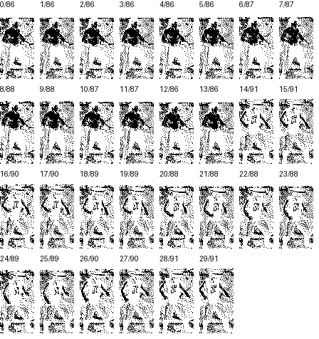

# Графические цепочки BANK0–BANK5

В шести исходных файлах восстановлены две непересекающиеся цепочки растровых записей, с начала и с конца каждого файла. Между ними остаются неизвестные промежутки. В промежутках BANK4 и BANK5 дополнительно найдены две пары записей. Всего распознаны 170 записей, 89046 байтов, из них 510 байтов заголовков и 88536 байтов изображений. Оригинальные байты не пересчитываются и не переворачиваются.

Названия BANK0..BANK5 являются именами файлов. Они не доказывают выбор физических страниц Spectrum. Значения меток в исходниках обозначают файловые смещения, исполнительные адреса этим ресурсам не назначены.

| Файл | Записей с начала | Записей с конца | Дополнительных записей | Графических байтов | Неизвестных байтов |
|---|---|---|---|---|
| BANK0 | 14 | 16 | 0 | 15954 | 430 |
| BANK1 | 14 | 14 | 0 | 14628 | 1756 |
| BANK2 | 14 | 14 | 0 | 14472 | 1912 |
| BANK3 | 14 | 14 | 0 | 14664 | 1720 |
| BANK4 | 14 | 12 | 2 | 14316 | 2068 |
| BANK5 | 14 | 12 | 2 | 15012 | 1372 |

Таблица учитывает только полные полосы. После двух дополнительных записей
частично сохранились ещё 324 байта BANK4 и 84 байта BANK5. После выделения
этих копий в BANK4 остаётся 1744 неизвестных байта, в BANK5 остаётся 1288.

## Физический формат записи

Каждая запись содержит реальный экземпляр FScreenBitmapStrip и непосредственно следующий за ним растр. ScreenAddress занимает два little endian байта по смещению 0, Height один байт по смещению 2. Растр занимает ровно `6*Height` байтов, по шесть последовательных байтов на строку, 48 пикселей при одном бите на пиксель. Поля ширины в заголовке нет.

Шаг строки установлен по цепочкам, а не принят по сходству одиночного изображения. Среди проверенных размеров строки от одного до шестнадцати байтов только шесть дают длинные последовательности согласованных заголовков во всех шести файлах. Прямой проход даёт по 14 записей с начала. Обратный проход от точного конца каждого файла однозначно восстанавливает последние цепочки, у каждого заголовка единственный подходящий предшественник.

ScreenAddress согласован с раскладкой ULA. Для столбца байтов X и строки Y слово равно `4000 OR ((Y AND C0)<<5) OR ((Y AND 07)<<8) OR ((Y AND 38)<<2) OR X`. У всех 170 заголовков X=0 и Y+Height=187. Например, 4D80 задаёт Y=101, Height=86, следующая запись начинается через `3+6*86=519` байтов. Это координатная интерпретация исходного слова, не адрес загрузки самого BANK.

Соседние записи основных цепочек образуют 83 пары одинаковой геометрии.
[Рисователь из внекаталожных секторов](BankStripArchiveConsumer.md) выбирает
по одному кадру обе полосы пары. Чётная выводится прямо в основной экран,
нечётная через буфер в экран страницы 7. Названия поз, персонажей и
движений, а также вход из активной игры остаются неизвестными.

Дополнительные пары BANK4 и BANK5 занимают файловые смещения 8734..9819. Каждая пара целиком совпадает с первыми двумя записями последней цепочки BANK3, включая заголовки и растры. Их исходники находятся в [BANK4/StripsAdditional.asm](../Source/Resources/37_BANK4/StripsAdditional.asm) и [BANK5/StripsAdditional.asm](../Source/Resources/38_BANK5/StripsAdditional.asm). Метки Strip26 и Strip27 сохраняют уже опубликованные имена остальных записей. Совпадение не доказывает использование копий игрой.

По смещению 265C в BANK4 и BANK5 идут точные начальные копии третьей
полосы последней цепочки BANK3. Заголовок `80 49 5A` задаёт адрес 4980
и высоту 90. В BANK4 за ним следуют 321 байт растра, 53 полных строки и
первые три байта следующей. В BANK5 сохранены 81 байт растра, 13 полных
строк и первые три байта следующей. По смещениям 27A0 и 26B0 начинаются
самостоятельные последние цепочки BANK4 и BANK5. Полосы не дополняются
до указанной высоты. Штатное чтение неполных копий не установлено.
[BANK4](../Source/Resources/37_BANK4/PartialStripCopy.asm),
[BANK5](../Source/Resources/38_BANK5/PartialStripCopy.asm),
[сверка исходных байтов](../Tools/Disasm/Reports/BankPartialStripCopiesVerification.json).

## Исходники и изображения

| Файл | Первая цепочка | Последняя цепочка | Просмотр |
|---|---|---|---|
| BANK0 | [StripsPrefix](../Source/Resources/33_BANK0/StripsPrefix.asm) | [StripsSuffix](../Source/Resources/33_BANK0/StripsSuffix.asm) | [Атлас](../Tools/Disasm/Research/Evidence/Bank0ScreenStrips.png) |
| BANK1 | [StripsPrefix](../Source/Resources/34_BANK1/StripsPrefix.asm) | [StripsSuffix](../Source/Resources/34_BANK1/StripsSuffix.asm) | [Атлас](../Tools/Disasm/Research/Evidence/Bank1ScreenStrips.png) |
| BANK2 | [StripsPrefix](../Source/Resources/35_BANK2/StripsPrefix.asm) | [StripsSuffix](../Source/Resources/35_BANK2/StripsSuffix.asm) | [Атлас](../Tools/Disasm/Research/Evidence/Bank2ScreenStrips.png) |
| BANK3 | [StripsPrefix](../Source/Resources/36_BANK3/StripsPrefix.asm) | [StripsSuffix](../Source/Resources/36_BANK3/StripsSuffix.asm) | [Атлас](../Tools/Disasm/Research/Evidence/Bank3ScreenStrips.png) |
| BANK4 | [StripsPrefix](../Source/Resources/37_BANK4/StripsPrefix.asm) | [StripsSuffix](../Source/Resources/37_BANK4/StripsSuffix.asm) | [Атлас](../Tools/Disasm/Research/Evidence/Bank4ScreenStrips.png) |
| BANK5 | [StripsPrefix](../Source/Resources/38_BANK5/StripsPrefix.asm) | [StripsSuffix](../Source/Resources/38_BANK5/StripsSuffix.asm) | [Атлас](../Tools/Disasm/Research/Evidence/Bank5ScreenStrips.png) |

Видны изображения человеческих фигур. В просмотре строки идут в порядке хранения, нулевой бит показан белым, единичный чёрным. Это соглашение просмотра, а не доказательство игровой палитры, ориентации или способа наложения. Растры не объявлены AND-масками и пикселями BD0..BD3. Их взаимосвязь с теми ресурсами и путь загрузки пока не найдены.

## Что сохраняется неизвестным

В исходных промежутках было 8850 байтов. В пяти из них
[побайтово совпали с внекаталожным блоком](BankStripArchiveConsumer.md)
3142 байта, из них 1200 оформлены как [копии маршрутов кадров](BankArchiveRouteCopies.md).
После [разметки копий растровых слоёв](BankArchiveTileLayers.md) в шести
промежутках остаются 5598 байтов с открытым назначением.
Таблицы архивного рисователя выбирают 166 полос основных цепочек.
Штатное использование дополнительных полос и неполных копий остаётся открытым.

[Декодер физического формата](../Tools/Disasm/Research/BankScreenStrips.py) и [проверка](../Tools/Disasm/Research/CheckBankScreenStrips.py) сверяют 691008 пиксельных битов, полный обратный проход, заголовки, все байты и чувствительность к неверной высоте. [Отчёт](../Tools/Disasm/Reports/BankScreenStripsVerification.json) разделяет распознанную разметку и недоказанный игровой договор. Обычная сборка использует STRUCT и INCBIN в SjASMPlus, исследовательский Python для неё не требуется.

Атласы показывают 166 записей основных цепочек. Четыре дополнительные записи проверяет [отдельная модель копий](../Tools/Disasm/Research/CheckAdditionalBankStrips.py), её [отчёт](../Tools/Disasm/Reports/AdditionalBankStripsVerification.json) сверяет все 2172 байта с исходным TRD и BANK3.
