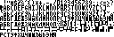

# Шрифт текстового окна CONTROL0

[Физический растр](../Source/Controls/Resources/TextFont4x6.bin), [состав CONTROL0](../Source/Files/22_CONTROL0.inc), [PrintTextGlyph](../Source/Controls/PrintTextGlyph.asm), [DrawGlyphRows](../Source/Controls/DrawGlyphRows.asm). [Декодер и обратная упаковка](../Tools/Disasm/Research/ControlsTextFont.py), [проверка](../Tools/Disasm/Research/CheckControlsTextFont.py).

По файловым смещениям 0600..086F находятся 624 исходных байта, загружаемые по C600..C86F банка 1. Это 104 пары знаков, каждая занимает шесть последовательных растровых строк. В каждом байте старшая тетрада содержит четыре пикселя чётного индекса, младшая — нечётного. Всего 208 знаков по 4 на 6 пикселей, 4992 физических бита. Растр сохранён без пересчёта.

PrintTextGlyph вычитает 20 из входного A по модулю 256, сбрасывает младший бит и умножает полученный индекс на три. Получается адрес пары C600+6*floor(((A-20) AND FF)/2). Чётность индекса отдельно передаётся рисователю. Выделенные 624 байта соответствуют входным кодам 20..EF. Начало следующего подтверждённого исполняемого фрагмента CopyViewportToScreen находится по C870.

Проверки диапазона во входе нет. Для оставшихся 48 кодов, 00..1F и F0..FF, читаются байты C870..C8FF, принадлежащие соседнему коду. Исходное поведение сохранено, размер шрифта не расширен копией инструкций и защита не добавлена. Нулевой код не считается специальным терминатором рисователя.

Перед растром остаются 186 неизвестных байтов C546..C5FF после массива точек. Нулевое заполнение не используется для объявления их свободными или неиспользуемыми.

Атлас 128 на 42 пикселя начинается с кода 20, строки идут по 32 знака. Единичный бит показан чёрным, это соглашение просмотра, игровая палитра определяется экраном. Последняя строка содержит 16 знаков и незаполненную половину ширины.

1024 сценария исполняют настоящий PrintTextGlyph, DrawGlyphRows и прокрутку для всех 256 входных байтов и колонок 0, 1, 23 и 24. Сверяются события вывода и память вне обычного стека и операнда SavedSP прокрутки. Обратная упаковка проверяет все 4992 бита, происхождение подтверждено непосредственно оригинальным TRD. Полные регистры, R, такты, общая кратность записей, IRQ, сборка и нативная игра не проверялись.
