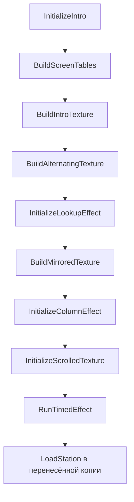

# Вступление и создаваемый код

## Загрузка и последовательность

Машинная часть BASIC-загрузчика читает 44 сектора в `#6400` и передаёт
управление `#6500`. Это исходные адреса игры, новая раскладка не вводится.
`InitializeIntro` переносит завершающий загрузчик в `#5D3B`, устанавливает
стек `#5FFF`, выводит исходный экран и переносит распаковщик из `#8931` в `#6E31`.
Затем создаёт рабочие таблицы и последовательно вызывает подготовительные
процедуры эффектов. `RunTimedEffect` выполняет выбранный через HL обработчик
до исчерпания BC либо до значения `#BE` в строке клавиатуры `#7FFE`.
Код сравнивает весь байт, отдельную маску нажатия Space он не проверяет.



Граф отражает порядок прямых вызовов. Подготовительная процедура может
завершаться через общий показ кадра, а следующий блок кода может быть
продолжением процедуры. Границы файлов не означают независимый `CALL`/`RET`.

## Таблицы и аппаратные страницы

`SelectIntroPage` записывает `#11` в `#7FFD`, выбирая банк 1.
Другие процедуры используют полный байт `#14` для банка 4 и `#16` для банка 6.
Текстуры проходят через постоянную область `#8000..#BFFF` и окно `#C000`.
`ExpandTextureRows` получает 64 строки по 64 байта из банка 4, добавляет IXL
к каждому байту modulo 256 и повторяет каждую строку до 256 байт.
Перекрывающийся `LDIR` здесь намеренный, расстояние источника и приёмника равно 64.

`BuildScreenTables` отражает часть координатной таблицы `#6400` и создаёт
поля экранных адресов в `#6000` и `#6100`. Остальные поля затем заполняются
указателями источников. `ScatterTextureToScreen` читает 38 записей по четыре
байта. Каждая запись содержит указатель на 32 слова источников и адрес
приёмника. По 32 парам `POP HL` и `LDI` получается одна строка экрана.

Для адресации второй половины `PresentInterlacedFrame` заменяет два байта
в `#6839` на `NOP NOP` либо `INC H NOP`. Байт `#67F2` переключается между
нулём и `#80`. Синхронизацию выполняет `EI / HALT / DI`, после неё источник
указателей можно читать через SP без вмешательства обычного IRQ.
Это собственный счётчик фазы, расположенный рядом код не является обработчиком IRQ.

## Создание развёрнутых цепочек

Исходные образцы находятся в `Source/IntroTemplates`. Они сохраняют
оригинальные байты, сами по своим исходным адресам через CALL не вызываются.

| Адрес результата | Построитель | Содержание и завершение |
| --- | --- | --- |
| `#7E00` | `InitializeScrolledTexture` | 64 копии по 7 байт, затем `JP #66F3` в `#7FC0` |
| `#68A9` | `BuildAttributeWriter` | 32 пары `POP HL / LD (nn),HL`, всего 128 байт |
| `#D000` | `InitializeColumnEffect` | 64 копии по 25 байт, затем RET в `#D640` |
| `#9100` | `InitializeLookupEffect` | 64 копии по 6 байт, последний INC C заменён `JP #6BED` в `#927F` |
| `#9900` | `InitializeLookupEffect` | 256 копий по 15 байт, INC E в `#A7FE` заменён RET, EXX в `#A7FF` недостижим |
| `#A800` | `InitializeLookupEffect` | 304 пары `POP HL / LD (nn),HL`, затем `JP #6BBC` в `#ACC0` |

В `#A800` выполняется перенос 608 байт по восьми словам в 38 страниц
`#C0..#E5`, младшие адреса каждой группы лежат в `#00..#0F`.
Переходы в `#66F3`, `#6BBC` и `#6BED` являются продолжениями после
генерируемого кода. Перед входом в цепочку исходный SP записывается в
операнд последующего `LD SP,nn`. Замена этих переходов на самостоятельные
вызовы нарушила бы соглашение со стеком.

## Параметры и масштаб

[AdvanceParameters](../Source/Intro/AdvanceParameters.asm) получает запись
FTexturePhase из трёх слов Phase, Step и StepDelta.
Сначала рассчитывается новый Step, затем новый Phase:

```text
newStep = Step + (bit15(Phase) ? -StepDelta : StepDelta) modulo 65536
newPhase = Phase + newStep modulo 65536
```

StepDelta не меняется. В A возвращается старший байт нового Phase.
При обработке используется временный стек, SP восстанавливается, выход
всегда разрешает прерывания через EI. Исходное состояние IFF не сохраняется.

[AdvanceTexturePhases](../Source/Intro/AdvanceTexturePhases.asm) обновляет три
физических экземпляра из [TexturePhases.asm](../Source/Intro/Data/TexturePhases.asm).
PhaseA управляет младшим байтом основного HL табличной выборки,
PhaseB альтернативным BC, PhaseC альтернативным HL.
Затем четвёртый параметр выбирается из IntroTables.PhaseSamples в странице `#64`
с шагом три по младшему байту указателя и делится на два. Переноса из L в H нет,
поэтому после индексов 253, 254 и 255 получаются 0, 1 и 2 в той же странице.
Этот параметр меняет младший байт альтернативного DE в RenderLookupTexture.

[CheckTexturePhases.py](../Tools/Disasm/Research/CheckTexturePhases.py) проверил
12288 сочетаний из всех младших байтов курсора и 48 профилей состояний.
Подтверждены поля трёх записей, изменяемые операнды выборки, сохраняемые
регистры, SP, IFF и полный F последнего SRL.
Результат — [TexturePhaseVerification.json](../Tools/Disasm/Reports/TexturePhaseVerification.json).
Внешние IRQ и весь текстурный эффект этим тестом не проверяются.

`SelectTexturePointerRow` рассчитывает `#F000 + 16*A` и записывает результат
в операнд `#6BB2`. Таблица `#F000` содержит 256 строк по 16 байт.
При её создании значение E ограничивается `#70..#7F`, затем получается
страница `#89 + ((E-#70) >> 1)`. Начальное E каждой строки берётся из D,
который уменьшается через итерацию.

## Граничное чтение ПЗУ

`BuildTextureLookup` сначала заполняет `#8000..#FFFF` значением `#FF`.
После размещения выборок два прохода заменяют незаполненные пары значениями
из следующей страницы. Для последней пары `#FFFE..#FFFF` следующая страница
оборачивается в `#00FE..#00FF`, то есть в ПЗУ. На проверенных состояниях
таблицы выходной A равен байту из `#00FF`.

Это существенно для `BuildIntroTexture`, где A после вызова используется
как счётчик подготовительного копирования. Значение `#2C`, переданное
построителю, задаёт код `INC IYL` вместо `LD IYL,A` и не является сохранённым
счётчиком. При выходном A=0 цикл делает 256 повторений. Финальный перенос
подготовленной текстуры в банк 4 всегда имеет длину `#1300`.

## Проверка

`Tools/Disasm/Research/CheckIntro.py` исполняет оригинальные Z80-байты
в изолированной модели SkoolKit. Отчёт `IntroVerification.json` содержит:

- 125 сочетаний трёх слов для формулы обновления состояния.
- Все 256 индексов `SelectTexturePointerRow`.
- Три контролируемых варианта граничных байтов ПЗУ.
- 15 вариантов шага и начала приёмника для `BuildPhaseTable`.
- Проверку всех 64 результатов объединения полубайтов.
- Сверку трёх фактически созданных цепочек в `#9100`, `#9900` и `#A800`.
- Сверку 128 байт писателя атрибутов и его 32 записей.
- Два варианта вставки экранного переноса, по 1216 байт каждый, с восстановлением SP.

Проверки не доказывают все входы всех эффектов, корректность произвольного
ПЗУ или прохождение игры. Проверка полного TRD и сообщения пользователя
о запуске в Unreal учитываются отдельно в `Docs/Validation.md`.
