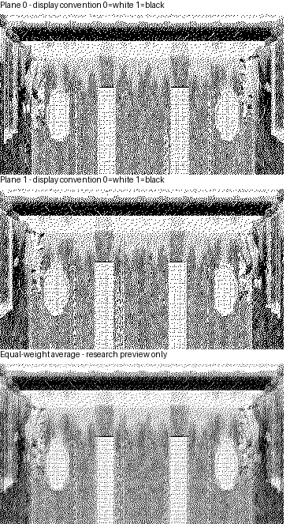

# Графический ресурс scene1po

В исходном логическом файле scene1po.s находятся 18676 байтов, после него в выделенных секторах остаются 12 байтов. [PixelPairs.bin](../Source/Resources/30_scene1po/PixelPairs.bin) сохраняет весь логический файл без преобразования, [SectorTail.bin](../Source/Resources/30_scene1po/SectorTail.bin) сохраняет отдельный секторный хвост. [Сборочный модуль](../Source/Files/30_scene1po.inc) включает оба блока в исходном порядке. Исполнительный адрес этому ресурсу не назначается, параметр каталога не считается доказательством загрузки в RAM.

Все 73 сектора совпали с `scene1po.s` в двух опубликованных архивах,
`AWAK_SDC.SCL` и `MKDEMO2.SCL`. Вызов загрузчика из ENGINE подтверждён
сквозной моделью архивного демо Mortal Kombat II.
[Сверка AWAK_SDC](../Tools/Disasm/Reports/ActionArchivedFileEndVerification.json)
· [Сверка MKDEMO2](../Tools/Disasm/Reports/ArchiveFighterReleaseVerification.json)

## Восстановленное изображение

Разделение чётных и нечётных байтов даёт две согласованные битовые плоскости. Исследовательская геометрия 368 пикселей на 203 строки точно покрывает весь логический файл. В каждой строке 46 байтов каждой плоскости, итого 92 байта чередующихся пар. В обеих плоскостях видны согласованные границы помещения, центральный проход и симметричные детали. Межстрочные повторения байтов с шагом 92 дополнительно согласуются с этой геометрией.

Геометрия просмотра получена по связному растру и периодичности. Позднее
[найденный загрузчик и рисователь](#код-во-внекаталожных-секторах) независимо
подтвердил шаг 92 и высоту 203. Усреднение на нижнем виде используется
только для исследования. Название локации и игровой вход ещё неизвестны.

## Адресация битов

Для строки y от 0 до 202, пикселя x от 0 до 367 и плоскости p, равной 0 либо 1, байт расположен по файловому смещению `92*y + 2*(x//8) + p`. Маска пикселя равна `80 >> (x AND 7)`. Старший бит байта рисуется первым. Первые два байта 90, 00 дают разные первые восемь пикселей плоскостей и сохранены буквально.

Интерпретация единицы как чёрного и нуля как белого выбрана для просмотра. Цвета, атрибуты, временное чередование, связь с гигаэкраном либо иное объединение плоскостей не установлены. Эти байты не объявляются парами AND-маски и пикселей по аналогии с BD0..BD3, в 5364 из 9338 пар их побитовое пересечение ненулевое.

[Описание](../Tools/Disasm/Research/Scene1PixelPairs.py) и [проверка](../Tools/Disasm/Research/CheckScene1PixelPairs.py) проверяют все 149408 битов по независимой адресной формуле, обратное преобразование восстанавливает все 18676 исходных байтов. [Отчёт](../Tools/Disasm/Reports/Scene1PixelPairsVerification.json) отдельно фиксирует границы доказательства. Обычная сборка включает только сохранённые байты и не зависит от Python или создания изображений. Упаковка TRD остаётся в SjASMPlus.

## Код во внекаталожных секторах

Блок по физическому смещению 8B100 согласуется с фиксированным
исполняемым адресом 4000. На входе байт `#5F5E` выбирает один из трёх
селекторов страниц. Записи в порты всех трёх вариантов проверены
отдельно, [связь с архивным меню](StartArchiveMenu.md). Вход 4916 копирует ключ `scene1pos` из 5040
и вызывает 3D13 с A=FF, C=0E и HL=7700. Сразу после возврата
он запрещает прерывания. [Исходник загрузчика](../Source/ArchiveEngine/LoadScenePixels.asm)

Слово `#4A4B` задаёт шаг 92 байта. Значение `#4A51` совпадает с высотой
203 строки, его читатель не установлен. При разбиении фона по `#492D`
шаг задаёт пропуск источника после 32 байтов экрана и смещение второй
части. Значение ширины 90 даёт начальный столбец `(90 − 32) / 2 = 29`.
[Разбиение фона](../Source/ArchiveEngine/PrepareScenePages.asm)
· [Поля сцены](../Source/ArchiveEngine/Data/Scene.asm)

В проверенной ветви расширенного селектора первые 178 строк занимают
3FF8 байтов по C000 страницы 13. Следующие 25 строк копируются по C054
страницы 14. Исходный второй LDIR выполняет 0958 итераций и дополнительно
читает 92 байта за логической длиной. Первые 12 лежат в фиксированной RAM
по BFF4..BFFF, остальные 80 берутся из уже выбранной страницы 14 по
C000..C04F. Два профиля с подстановкой внешней загрузки проверяют оба
варианта RAM, с байтами секторного хвоста и с прежними байтами.

Третий профиль выполняет исходный `#3D13` в ПЗУ TR-DOS 5.04T. Первые
72 сектора идут прямо по `#7700..#BEFF`, последний сектор 16 дорожки 91
читается во временный буфер `#5D25`. В RAM по `#BF00..#BFF3` попадают
только 244 оставшихся байта файла. После загрузки контрольные значения
по `#BFF4..#BFFF` сохранились и попали в страницу 14 через второй `LDIR`.
Все 12 дисковых байтов секторного хвоста прошли через `#5D25`, а в
содержимое страницы 14 вошли прежние 12 байтов фиксированной RAM.

Цикл 4A00 копирует 32 соседних байта исходной строки в bitmap и добавляет
60 к уже продвинутому указателю. Полный шаг источника равен 92. Адрес
назначения идёт вверх в пределах группы из восьми строк. Проверены
четыре окна обеих страниц, включая первую и последнюю строки.
Этот путь выводит соседние байты непосредственно. Плоскости на атласе
остаются отдельным способом просмотра, игровое усреднение не подтверждено.

## Полный фон кадра

Архивный цикл бойцов вызывает вход #4974. Он выбирает экранный банк 7
и вычисляет начало окна в фиксированной RAM по формуле
`#7700 + 92 × ViewY + ViewX`. Исходные границы ViewX равны 0..58,
границы ViewY равны 0..11. Вывод идёт снизу вверх. Исходная строка
для экранной строки y равна `ViewY + 191 − y`.

В строки экрана 191..25 и 14..0 копируются по 32 соседних байта,
начиная с ViewX. В строки 24..15 копируются только байты столбцов
15 и 16. Остальные пиксели этих строк и все атрибуты сохраняются.
Суммарно за вызов записываются 5844 байта. Окно выбирается в общей
RAM, банк 7 служит назначением, а копии сцены в расширенных банках
13 и 14 этот вход не читает.

После загрузки исходным ROM TR-DOS сверены все 708 положений окна.
Сравнены порядок чтений и все 6912 байтов экрана, включая сохранённые
ячейки. В совокупности этот вход использует первые 90 из 92 байтов
каждой из 203 строк. Два последних байта каждой строки и дополнительные
байты за логическим файлом в эти чтения не попадают. Путь к архивному
циклу из активного Awaken остаётся открытым.
[Трасса полного фона](../Tools/Disasm/Reports/Scene1ArchiveConsumerVerification.json)
· [Вывод окна](../Source/ArchiveEngine/ShowViewport.asm)
· [Перенос полных строк](../Source/ArchiveEngine/CopyViewportRows.asm)
· [Вывод цифр между полосами](ArchiveEngineTimerRaster.md)

## Восстановление фона под бойцом

Перед новым наложением вход #46EE убирает предыдущий кадр бойца из
общей сцены по #7700. Указатель назначения берётся из прежней записи
бойца. Для зеркального кадра из него вычитается `ширина − 1`,
чтобы начать копирование с левого края. Ширина и высота относятся
к предыдущему кадру, как и координаты восстанавливаемого прямоугольника.

Исходная сцена для восстановления находится в расширенных банках.
Вход начинает с банка 13, адрес источника получается прибавлением
#4900 к адресу назначения. После каждой строки оба указателя
продвигаются на 92 байта. Перед строкой 178 проверка по #4721
переключает банк на 14, а #4744 переводит источник к #C054 с
прежним горизонтальным смещением. Равенство 178 проверяется на
каждой строке, поэтому отдельный старт ниже этой границы данным
договором не покрывается.

Сверены 1200 вызовов с 45 физическими сочетаниями ширины и высоты
и отдельным однобайтовым профилем на границе. В 648 вызовах
исполнен переход в банк 14, в том числе в 12 запусках с первой
строкой 178. Исходный цикл бойцов после загрузки через ROM
прочитал 70 535 байтов банка 13 по #472C за 64 кадра без клавиш
и четыре кадра с двумя нажатиями и отпусканиями. Банк 14 на
кадровом участке этого прогона не читался, его путь проверен
отдельным входом #46EE с подготовленными прямоугольниками.
[Трасса восстановления](../Tools/Disasm/Reports/FighterArchiveConsumerVerification.json)
· [Восстановление фона](../Source/ArchiveEngine/RestoreFighterBackground.asm)
· [Переход на вторую страницу](../Source/ArchiveEngine/SwitchSceneTail.asm)

[Сценарий](../Tools/Disasm/Research/CheckScene1ArchiveConsumer.py) и
[отчёт](../Tools/Disasm/Reports/Scene1ArchiveConsumerVerification.json)
проверяют исходные процедуры загрузки, разбиения и копирования окна.
Профиль с ПЗУ использует модель контроллера, подготовленные системные
переменные и стек. Расширенный селектор моделируется во всех трёх
профилях. Вход из активной игры остаётся открытым.

## Оставшиеся поля записи сцены

Физическая [запись сцены](../Source/ArchiveEngine/Data/Scene.asm)
содержит SourceRows по #4A51..#4A52, исходно 203, и Unknown0B
по #4A56, исходно ноль. Значение 203 совпадает с высотой scene1po,
но совпадение размера не доказывает использование слова кодом.
Статическая сверка всех 1325 зарегистрированных инструкций ENGINE
с исходными дисковыми байтами не нашла прямых обращений к этим трём
байтам. Проверены также двухбайтовые чтения и записи, начинающиеся
за один байт до наблюдаемого адреса.
[Статический результат](../Tools/Disasm/Reports/ArchiveSceneUnknownFieldsInspection.json)
воспроизводится функцией `inspect_scene_fields` из
[исследовательского сценария](../Tools/Disasm/Research/InspectArchiveFighterUnknownFields.py).

Дополнительно [наблюдатель исходного исполнения](../Tools/Disasm/Research/CheckArchiveFighterUnknownFieldTrace.py)
расширен на эти адреса и соседний VerticalOffset по #4A55.
Его чтения и записи подтвердились в восьми группах по командам
и адресам. Отдельные шесть контрольных запусков настоящих LD через HL
подтвердили наблюдение чтений и записей каждого из трёх неизвестных
байтов, после контроля счётчики очищены.

В [модельном прогоне](../Tools/Disasm/Reports/ArchiveSceneFieldAccessModelVerification.json)
есть 408 шагов бойцов, 336 отрисовок масок, 2560 проверок изменения
окна, подготовка ресурсов, 64 полных кадровых цикла без клавиш
и четыре цикла нажатий и отпусканий. Обращений к SourceRows и
Unknown0B не наблюдалось. Выполнялись все 140 зарегистрированных
мест косвенных операций и блочных переносов, найденных статическим
реестром, что не означает перебор всех их значений указателей.
[Результат наблюдения](../Tools/Disasm/Reports/ArchiveSceneUnknownFieldTraceVerification.json).

Обработка дисковых запросов подменена моделью, аппаратные прерывания
подаются на границах кадров. Обращения вне вызовов Simulator.run
не наблюдаются. Изменяемые команды и иные игровые пути полностью
не исключены. Поэтому поля не переименованы в резерв или заполнение,
их общее назначение остаётся открытым. Прежние отчёты наблюдения
байтов бойцов и исходной модели сохранены побайтно.
