# Станционные фоны

Формат знакомест описан в [Rendering](Rendering.md).
Распаковка выполнена исходной процедурой #9EFF в изолированной модели.

## Запись 9, блок 0

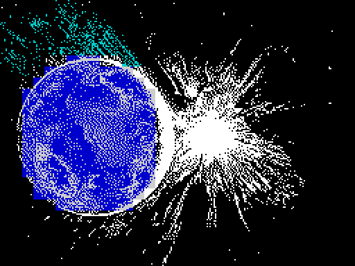

## Запись 9, блок 1

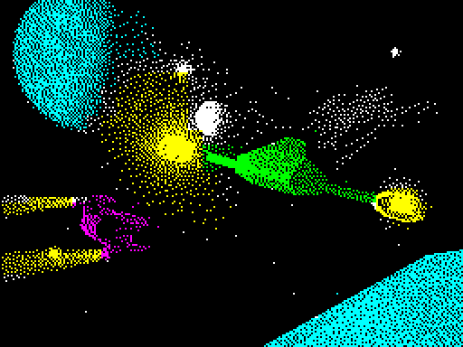

## Запись 9, блок 2

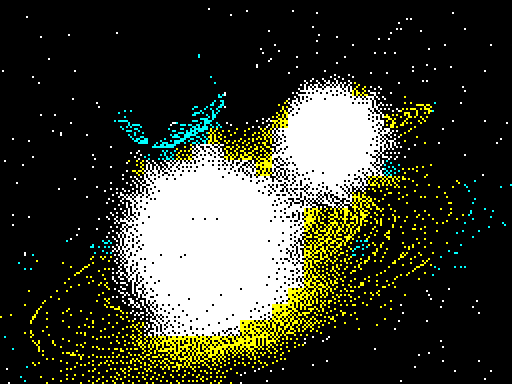

## Запись 9, блок 3

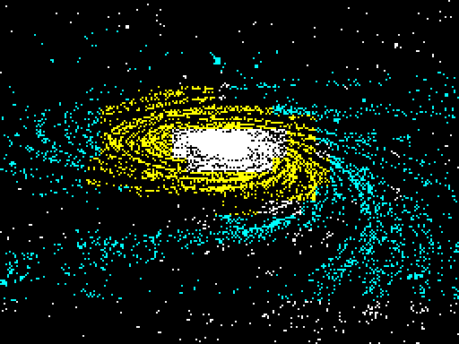

## Запись 9, блок 4

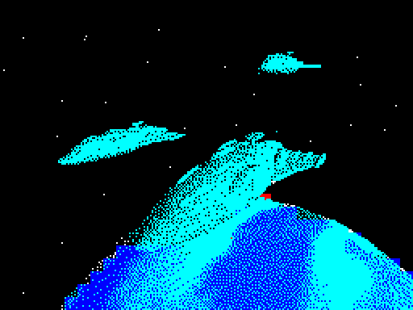

## Запись 9, блок 5

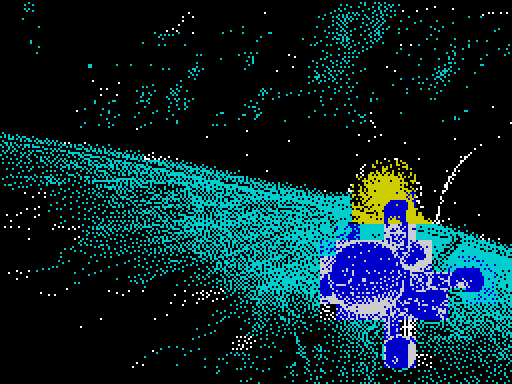

## Запись 9, блок 6

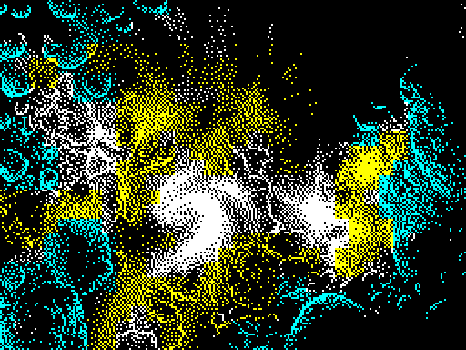

## Запись 9, блок 7

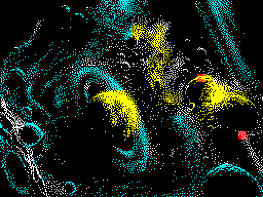

## Запись 9, блок 8

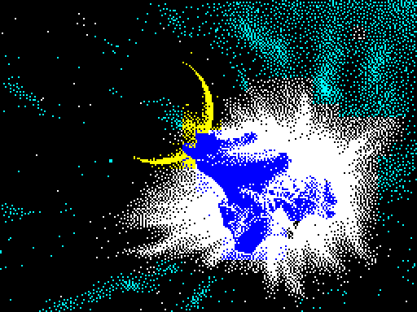

## Запись 9, блок 9

## Запись 9, блок 10

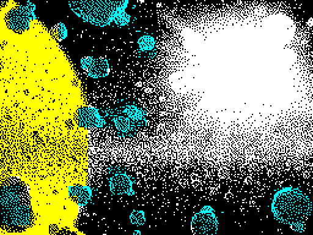

## Запись 9, блок 11

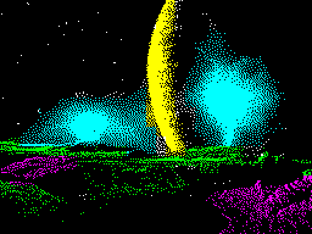

## Запись 9, блок 12

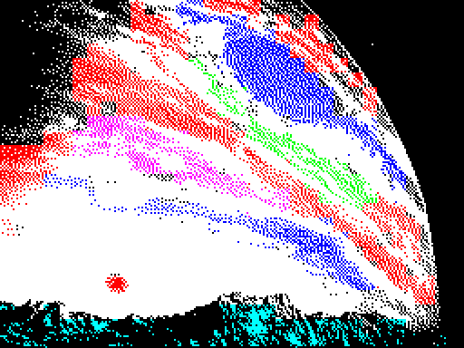

## Запись 9, блок 13

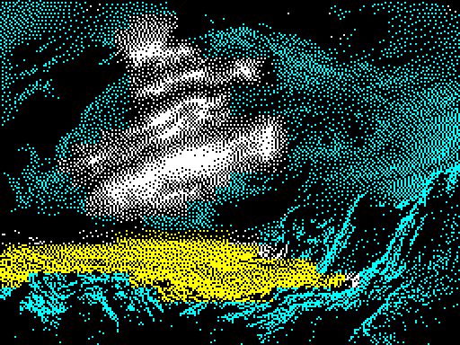

## Запись 9, блок 14

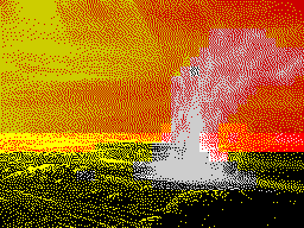

## Запись 9, блок 15

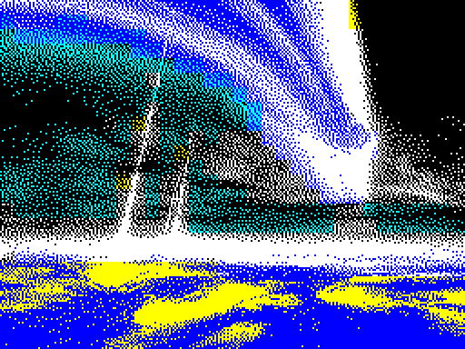

## Запись 25, блок 0

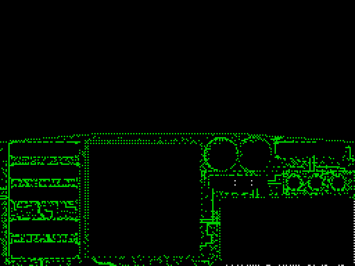

## Запись 26, блок 0

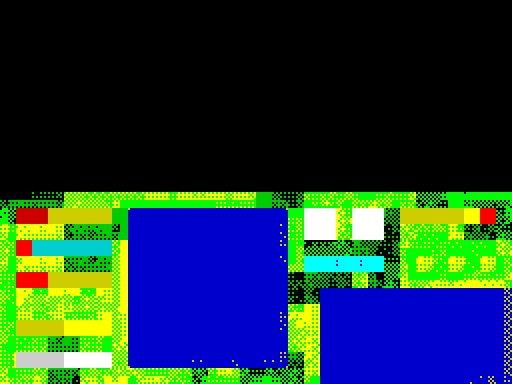

## Запись 27, блок 0

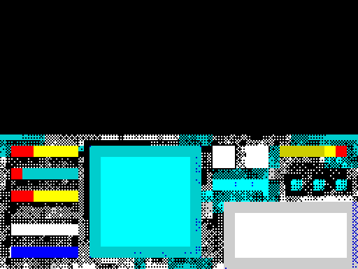

## Запись 28, блок 0

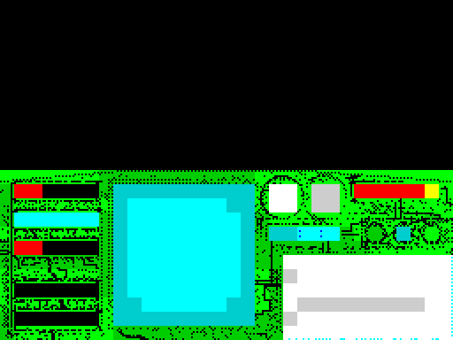
